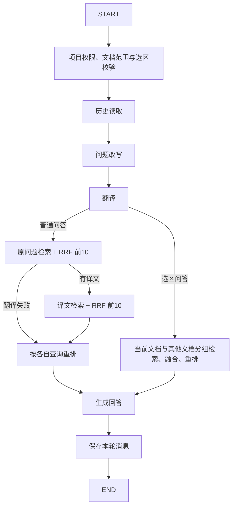
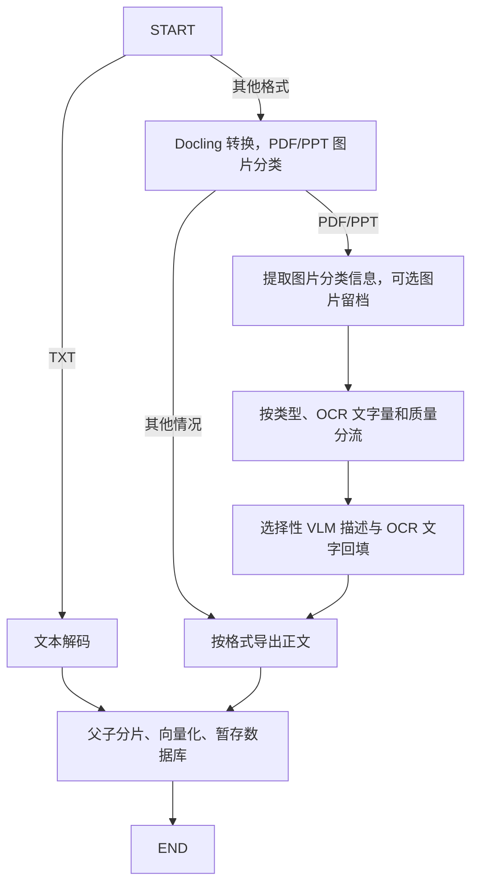

# LangGraph 问答与文档流程

当前恢复分支：`codex/test-docling-picture-description`。使用 `langgraph==1.2.14`，依赖已加入 `requirements.txt`。

```powershell
agent/Scripts/python.exe -m pip install -r requirements.txt
agent/Scripts/python.exe -m uvicorn main:app --host 127.0.0.1 --port 8000
```

## 问答图



原问题仅评分原问题候选，译文仅评分译文候选。同一子片跨路出现时取较高分，然后按分数 > 0.3、父片去重和最多 5 个父片筛选。选区问答在两个文档范围中分别执行这一策略，并沿用当前文档优先的名额分配。

## 文档图




后台任务仍负责文件读取、状态更新和最终事务提交。图中任一节点失败，会沿原有处理逻辑回滚分片并将文档标记为 failed。转换阶段关闭图片描述；`images_type_router` 使用 RapidOCR、文字量和 Surya 质量检查决定 `ocr`、`vlm` 或 `skip`。文字量沿用中文字符数加英文单词/数字串数：≤5 为极少，6–20 为短文本，>20 为长文本；OCR 逐行平均置信度需 >0.8，长文本还需 Surya 返回 `good`。

`enrich_images` 只对 `vlm` 图片调用 GLM，保留 Docling 图片描述与元数据封装，请求层由 `picture_api.py` 保留 HTTP 状态码和服务端错误码；仅此分支需要 `ZHIPU_API_KEY`。同一进程中的 VLM 请求串行执行，429、临时服务错误和网络异常最多尝试 4 次，退避间隔为 5/10/20 秒；遵守 `Retry-After`，超过 60 秒则停止本次尝试，不提前重试。认证等非临时错误立即失败。

OCR/VLM 文本写回原 `PictureItem.meta.description`，再导出并分片；`skip` 保留原图片节点。长度截断时仅对当前图片将输出上限提高至 32768 重试一次；持续截断、缺少图片像素、空描述或内容过滤仍会报错，不会作为成功内容入库。日志记录图片 ID、页码、结束原因、HTTP 状态和 API 错误码，不记录图片数据、正文或密钥。RapidOCR 和 Surya 按需加载并缓存，当前环境的 Surya 使用进程内预测器。

## 代码位置与日志

- `app/services/workflow_graphs.py`：TypedDict 状态与两张 StateGraph 的节点、边和条件分支。
- `app/routers/rag_flow.py::user_asking`：问答节点实现及图调用。
- `app/services/chunk.py::chunking`：文档节点实现及图调用。
- `app/services/startup.py`：服务启动预加载模型，继续复用缓存。

节点耗时自动写入 `logs/performance.log`，阶段名为 `graph.qa.*` 和 `graph.document.*`，与已有阶段沿用同一 trace。日志不输出图状态或正文。

图按调用构建，节点闭包持有本次调用的 Session 和请求依赖，避免跨请求共享数据库会话。节点顺序执行，不并行使用同一个 Session。文档任务与新增异步问答任务使用 `durable_workflows.py` 的数据库节点检查点、租约和恢复扫描；原同步问答保持原调用方式。最终数据库写入与任务完成同事务提交，不缓存未提交写入。失败任务通过接口重试，服务中断的任务在租约过期后恢复。完整接口和恢复边界见 [后端补齐说明](backend-completion.md)。模型与检索算法不因引入图而改变。

设计参考：[LangGraph 官方 Graph API 文档](https://docs.langchain.com/oss/python/langgraph/graph-api)。
